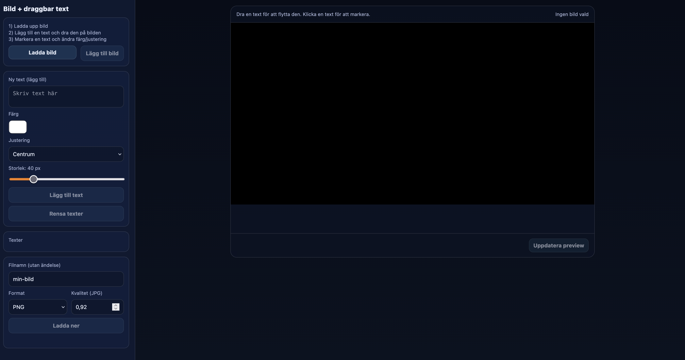
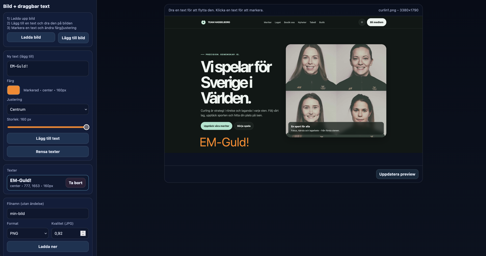

# Text-On-Image
Ladda upp bild. Skriv text, välj färg och storlek. Lägg texten på bilden och placera texten var du vill. Lägg till fler texter med annan storlek och färg. Ladda ner och spara som ny bild.

---

